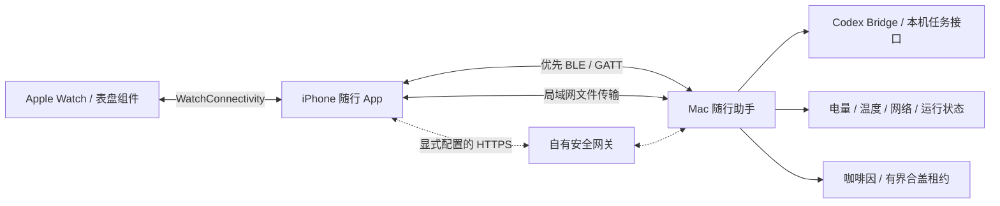

# 架构

BLE负责发现、配对、状态和小消息；文件传输按通道和大小选择可用路径。Watch不依赖Mac直接无线连接。iOS后台恢复通过系统蓝牙/WatchConnectivity调度，不能承诺固定频率永久运行。

移动办公的无限会话在应用层没有截止时间，系统侧仍使用2小时保护租约，在剩余1小时内续期。续期失败停止会话并尝试恢复原基线。预先由用户开启的系统合盖策略不属于本会话，结束时不会擅自关闭。

`Sources/CodexMobility*`：跨设备状态、控制、文件与电源策略。
`Sources/CodexWatch*`：任务模型、Bridge、手机、手表、App Intents、组件。
`Sources/WristArena*`：内置腕上互动模块。
`AppTargets`：各平台入口、权限描述和资源。
